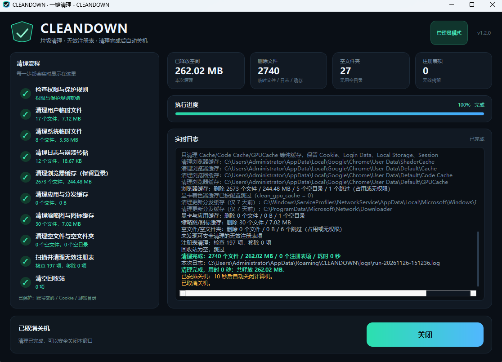

# CLEANDOWN

一键清理缓存垃圾、可按需自动关机的小工具。只清理缓存类数据，不碰个人文件和登录状态。



[](https://github.com/qupeng23/CLEANDOWN/releases/latest)

> 说明：本仓库源码是根据 `CLEANDOWN 1.2.0 使用说明` 重建的等价实现，使用 Python 标准库编写，可由 PyInstaller 打包为单文件 EXE。

## 功能

- 清理 Chromium 内核浏览器缓存：Edge、Chrome、夸克、豆包等
- 清理系统临时文件、崩溃报告、错误报告队列
- 清理 Windows 更新下载缓存与传递优化缓存
- 清理回收站
- 可选清理显卡着色器缓存（默认关闭）
- 可选清理 pip / uv 包缓存（默认关闭）
- 记录无效卸载残留（只记录，不自动删除注册表）
- 清理完成后按倒计时自动关机，界面可取消

## 不会碰什么

- 浏览器登录状态、账号密码、书签、浏览记录
- 桌面、文档、下载、图片、视频等任何个人文件
- 游戏本体、配置、着色器缓存
- 已安装软件的正常卸载信息

## 使用

直接运行源码：

```powershell
python cleandown.py
```

程序会请求管理员权限。启动后自动扫描并清理，默认 10 秒后关机；点击右侧「取消关机」可中止。关闭窗口即退出，不驻留后台。

## 配置

首次运行后生成配置文件：

```
%APPDATA%\CLEANDOWN\CLEANDOWN.ini
```

用记事本打开即可修改：

```ini
[CLEANDOWN]
shutdown_enabled = 1    ; 1=清理后自动关机，0=只清理不关机
shutdown_seconds = 10   ; 关机倒计时秒数
dry_run          = 0    ; 1=只扫描不删除、不关机
force_shutdown   = 0    ; 1=强制结束所有程序再关机（可能丢失未保存内容）
clean_gpu_cache  = 0    ; 1=清理显卡着色器缓存（游戏首次进图会重新编译）
clean_dev_cache  = 0    ; 1=清理 pip / uv 包缓存（下次装包需重新联网）
```

为安全起见，强烈建议先用 `dry_run = 1` 跑一次，确认日志里的清理范围符合预期。

## 日志

每次运行记录保存在：

```
%APPDATA%\CLEANDOWN\logs\
```

只在排查问题时需要，可随时删除。

## 从源码打包 EXE

```bat
pyinstaller --onefile --noconsole --name CLEANDOWN cleandown.py
```

生成物在 `dist\CLEANDOWN.exe`。安装包 `CLEANDOWN_Setup_1.2.0.exe` 使用 Inno Setup 等工具制作，作为 Release 附件发布，不直接提交进仓库。

## 许可

MIT，详见 [LICENSE](LICENSE)。
